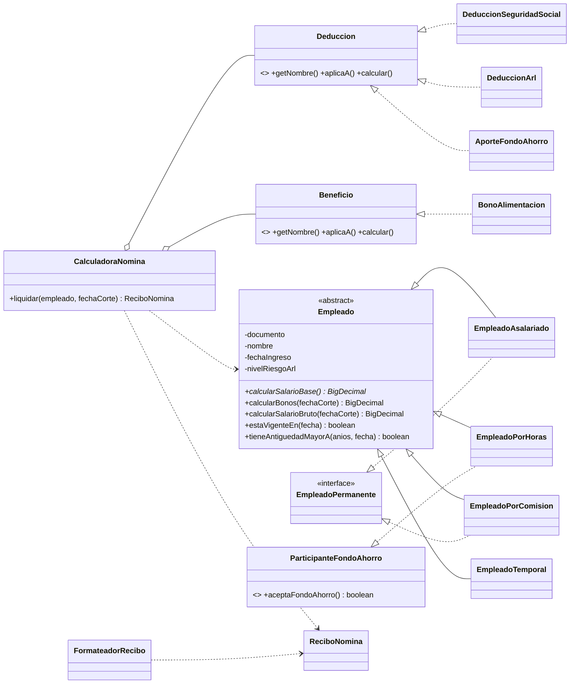

# Sistema de Nómina — Programación Orientada a Objetos

Sistema de nómina en **Java 17** para una empresa con cuatro tipos de empleado
(asalariado, por horas, por comisión y temporal). Cada uno calcula a su manera su
salario, sus bonos, sus deducciones y sus beneficios.

El proyecto aplica **principios SOLID**, **código limpio**, **refactorización**,
**comentarios de código (Javadoc)** y **pruebas unitarias con JUnit 5**.
El historial de Git sigue **Git Flow** y **Conventional Commits**.

> Actividad Unidad Tres — Entrega CIPA.

---

## Contenido

1. [Cómo ejecutarlo](#cómo-ejecutarlo)
2. [Reglas de negocio implementadas](#reglas-de-negocio-implementadas)
3. [Supuestos](#supuestos)
4. [Arquitectura](#arquitectura)
5. [Principios SOLID aplicados](#principios-solid-aplicados)
6. [Código limpio y refactorización](#código-limpio-y-refactorización)
7. [Pruebas unitarias](#pruebas-unitarias)
8. [Metodología de desarrollo](#metodología-de-desarrollo)
9. [Control de versiones](#control-de-versiones)

---

## Cómo ejecutarlo

Requisitos: **JDK 17 o superior** y **Maven 3.8+**.

```bash
# Ejecutar las pruebas unitarias
mvn test

# Ejecutar la aplicación de demostración (imprime un recibo por cada tipo de empleado)
mvn compile exec:java
```

Sin Maven también se puede compilar y ejecutar la demostración:

```bash
javac -d out $(find src/main -name "*.java")
java -cp out com.empresa.nomina.App
```

Salida de la demostración (fecha de corte 31/10/2026):

| Empleado | Tipo | Salario bruto | Deducciones | Beneficios | **Neto** |
|---|---|---:|---:|---:|---:|
| Laura Gómez | Asalariado (más de 5 años) | $3.300.000 | $149.226 | $1.000.000 | **$4.150.774** |
| Carlos Ruiz | Por horas (45 h, fondo de ahorro) | $950.000 | $66.918 | $0 | **$883.082** |
| Ana Torres | Por comisión (ventas $25 M) | $3.500.000 | $158.270 | $1.000.000 | **$4.341.730** |
| Pedro Díaz | Temporal | $2.000.000 | $90.440 | $0 | **$1.909.560** |

---

## Reglas de negocio implementadas

| Tipo | Salario base | Bonos | Beneficios |
|---|---|---|---|
| **Asalariado** | Salario fijo mensual | 10 % del salario si lleva **más de 5 años** | Bono de alimentación $1.000.000 |
| **Por horas** | Horas × tarifa; las horas **por encima de 40** se pagan a **1,5×** | No recibe | Fondo de ahorro (2 %) si lleva **más de 1 año** y **aceptó** el fondo |
| **Por comisión** | Salario base + % de comisión sobre ventas | 3 % de las ventas si **superan $20.000.000** | Bono de alimentación $1.000.000 |
| **Temporal** | Salario fijo mensual, contrato a término definido | No recibe | No recibe |

**Deducciones obligatorias (todos):**

- Seguro social y pensión: **4 %** del salario bruto.
- ARL: porcentaje del salario bruto según la clase de riesgo del empleado
  (I = 0,522 %, II = 1,044 %, III = 2,436 %, IV = 4,35 %, V = 6,96 %).

**Validaciones:**

- Ningún empleado puede tener salario neto negativo → `ValidacionNominaException`.
- Las horas trabajadas no pueden ser negativas → `ValidacionNominaException`.
- Las ventas no pueden ser menores a $0 → `ValidacionNominaException`.
- Además: salarios y tarifas no negativos, comisión entre 0 y 1, nombre y documento obligatorios,
  fin de contrato posterior al ingreso, y no se liquida a un temporal con el contrato vencido
  → `ContratoNoVigenteException`.

**Fórmulas:**

```
Salario bruto = salario base + bonos
Salario neto  = salario bruto − deducciones + beneficios
```

## Supuestos

El enunciado deja abiertos algunos puntos; estas son las decisiones tomadas
(cada una está aislada en una sola clase, así que cambiarla es sencillo):

1. **ARL:** el enunciado no da el porcentaje, se usa la tabla oficial colombiana
   por clase de riesgo; cada empleado tiene su clase (por defecto en los ejemplos, riesgo I).
2. **"Más de 5 años" / "más de 1 año":** se exige superar el plazo; con el aniversario exacto
   todavía no aplica (`Empleado.tieneAntiguedadMayorA`).
3. **Horas extra:** el umbral de 40 horas se aplica a las horas registradas en el periodo liquidado.
4. **Bono de alimentación:** es un pago no salarial; se suma al neto pero no hace parte de la base
   de las deducciones.
5. **Fondo de ahorro:** el 2 % se toma del salario del mes y se deposita en el fondo
   a nombre del empleado, por eso aparece como descuento en el recibo (`AporteFondoAhorro`).
6. **Dinero:** se usa `BigDecimal` y se redondea cada concepto a pesos enteros (mitad hacia arriba).

---

## Arquitectura

```
src/main/java/com/empresa/nomina
├── App.java                       Demostración por consola
├── modelo/                        Entidades del dominio
│   ├── Empleado.java              Clase abstracta (Template Method)
│   ├── EmpleadoAsalariado.java
│   ├── EmpleadoPorHoras.java
│   ├── EmpleadoPorComision.java
│   ├── EmpleadoTemporal.java
│   ├── EmpleadoPermanente.java    Interfaz: tiene beneficios de permanentes
│   ├── ParticipanteFondoAhorro.java  Interfaz: puede acceder al fondo
│   └── NivelRiesgoArl.java        Enum con las tarifas de ARL
├── reglas/                        Reglas de negocio intercambiables
│   ├── Deduccion.java             Interfaz
│   ├── DeduccionSeguridadSocial.java
│   ├── DeduccionArl.java
│   ├── AporteFondoAhorro.java
│   ├── Beneficio.java             Interfaz
│   └── BonoAlimentacion.java
├── servicio/                      Casos de uso
│   ├── CalculadoraNomina.java     Liquida la nómina (recibe las reglas por constructor)
│   ├── ReglasNominaPorDefecto.java  Arma la calculadora con las reglas de la empresa
│   ├── ReciboNomina.java          Resultado inmutable (record)
│   └── ConceptoNomina.java
├── presentacion/
│   └── FormateadorRecibo.java     Convierte un recibo en texto
├── excepciones/                   ValidacionNominaException, ContratoNoVigenteException
└── util/                          Validaciones, Dinero
```

Diagrama de clases (se ve como imagen en GitHub):



---

## Principios SOLID aplicados

| Principio | Dónde se ve |
|---|---|
| **S** — Responsabilidad única | `Empleado` calcula salario y bonos; `Deduccion`/`Beneficio` calculan un concepto cada uno; `CalculadoraNomina` arma el recibo; `FormateadorRecibo` solo lo presenta; `Validaciones` solo valida. |
| **O** — Abierto/cerrado | Un tipo de empleado nuevo es una subclase nueva. Una deducción o beneficio nuevo es una clase que implementa la interfaz y se registra en `ReglasNominaPorDefecto`; la calculadora no cambia (lo demuestra la prueba `permiteAgregarDeduccionesNuevas`). |
| **L** — Sustitución de Liskov | Todas las subclases se usan como `Empleado` sin condicionales por tipo; `calcularSalarioBruto` es `final` y todas devuelven montos no negativos. |
| **I** — Segregación de interfaces | Interfaces pequeñas: `EmpleadoPermanente`, `ParticipanteFondoAhorro`, `Deduccion`, `Beneficio`. Ningún empleado implementa métodos que no usa. |
| **D** — Inversión de dependencias | `CalculadoraNomina` depende de las abstracciones `Deduccion` y `Beneficio`, que recibe por constructor; las clases concretas solo se conocen en `ReglasNominaPorDefecto`. |

## Código limpio y refactorización

- **Nombres del dominio en español** que dicen qué hacen: `calcularSalarioBruto`, `tieneAntiguedadMayorA`, `registrarHoras`.
- **Sin números mágicos:** las reglas son constantes con nombre (`HORAS_JORNADA_NORMAL`, `UMBRAL_VENTAS_BONO`, `PORCENTAJE_BONO_ANTIGUEDAD`).
- **Métodos cortos** con un solo nivel de abstracción y **sin duplicación** (validaciones y redondeo centralizados).
- **Inmutabilidad:** `ReciboNomina` y `ConceptoNomina` son `record`; las listas se copian con `List.copyOf`.
- **`BigDecimal`** para dinero (nunca `double`).
- **Fallar rápido:** los datos inválidos se rechazan al crearse o registrarse, con mensajes claros.
- **Javadoc** en clases y métodos públicos explicando el *porqué*, no solo el *qué*.
- **Refactorización documentada en Git:** la rama `refactor/horas-extra` reemplaza un cálculo con
  números mágicos y un `if/else` por constantes y métodos extraídos (`horasNormales`, `horasExtra`,
  `calcularPagoHorasExtra`), con las pruebas en verde antes y después del cambio.

## Pruebas unitarias

52 pruebas con **JUnit 5** (`src/test/java`), organizadas en el mismo paquete de la clase probada,
con el patrón **Preparar – Actuar – Verificar** y nombres descriptivos (`@DisplayName`).

| Clase de prueba | Qué verifica |
|---|---|
| `EmpleadoAsalariadoTest` | Salario fijo, bono con más de 5 años, límite exacto de 5 años, validaciones |
| `EmpleadoPorHorasTest` | 40 horas, horas extra a 1,5×, fracciones, sin bonos, horas y tarifa negativas |
| `EmpleadoPorComisionTest` | Comisión, umbral exacto de $20 M, bono 3 %, ventas negativas, % inválido |
| `EmpleadoTemporalTest` | Salario fijo, vigencia del contrato, fecha fin inválida |
| `DeduccionesTest` | Seguro social 4 %, ARL riesgo I y V |
| `AporteFondoAhorroTest` | Elegibilidad (tipo, aceptación, antigüedad) y 2 % |
| `BonoAlimentacionTest` | Solo permanentes, valor fijo |
| `CalculadoraNominaTest` | Liquidación completa de los 4 tipos, contrato vencido, neto negativo, extensibilidad |
| `FormateadorReciboTest` | Contenido del recibo impreso |
| `ValidacionesTest`, `DineroTest` | Utilidades de validación y redondeo |

```bash
mvn test
# Tests run: 52, Failures: 0, Errors: 0, Skipped: 0
```

---

## Metodología de desarrollo

Se usó una metodología **ágil basada en Scrum**, adaptada a un equipo pequeño,
combinada con **TDD (desarrollo guiado por pruebas)**.

**Roles:** el estudiante asumió los roles de *Product Owner* (interpretar las reglas del enunciado),
*Scrum Master* (organizar el tiempo) y *equipo de desarrollo*.

**Product backlog** (historias de usuario tomadas de las reglas de negocio):

| # | Historia de usuario | Sprint |
|---|---|---|
| HU-01 | Como empresa quiero validar los datos de entrada para no liquidar valores imposibles | 1 |
| HU-02 | Como empresa quiero liquidar a un asalariado con su bono por antigüedad | 1 |
| HU-03 | Como empresa quiero pagar las horas extra de los empleados por horas | 1 |
| HU-04 | Como empresa quiero pagar comisiones y bono por ventas altas | 1 |
| HU-05 | Como empresa quiero pagar a temporales solo durante su contrato | 1 |
| HU-06 | Como empresa quiero descontar seguro social, pensión y ARL | 2 |
| HU-07 | Como empleado permanente quiero recibir el bono de alimentación | 2 |
| HU-08 | Como empleado por horas quiero ahorrar en el fondo de la empresa | 2 |
| HU-09 | Como empresa quiero un recibo con el neto de cada empleado, nunca negativo | 3 |
| HU-10 | Como equipo queremos mejorar el diseño sin cambiar el comportamiento | 3 |

**Sprints:**

1. **Sprint 1 – Modelo:** validaciones, clase abstracta `Empleado` y los 4 tipos.
2. **Sprint 2 – Reglas:** deducciones y beneficios como clases intercambiables.
3. **Sprint 3 – Integración y calidad:** calculadora, recibo, demostración, refactorización y documentación.

Cada sprint cerró con revisión (todas las pruebas en verde y demostración) y retrospectiva
(qué mejorar en el siguiente). La **definición de terminado** fue: código compilando sin advertencias,
pruebas unitarias en verde, Javadoc en lo público y rama integrada a `develop`.

**Ciclo TDD** en cada historia: 🔴 escribir la prueba que falla → 🟢 escribir el código mínimo que la
pasa → 🔵 refactorizar con las pruebas en verde. En el historial se ve, por ejemplo, el commit
`test:` del empleado asalariado antes del commit `feat:` que lo implementa.

## Control de versiones

Se siguió **Git Flow**:

- `main`: versiones estables (etiqueta `v1.0.0`).
- `develop`: integración de lo terminado en cada sprint.
- `feature/*`: una rama por grupo de historias de usuario, integrada con `merge --no-ff`
  para conservar la historia.
- `refactor/*`: cambios de diseño sin cambiar el comportamiento.

Los mensajes de commit siguen **Conventional Commits** (`feat:`, `test:`, `refactor:`, `docs:`, `chore:`).

```bash
git log --oneline --graph --all
```

### Publicar en GitHub

```bash
# 1. Crear un repositorio vacío en GitHub (sin README) llamado sistema-nomina
# 2. Desde la carpeta del proyecto:
git remote add origin https://github.com/<tu-usuario>/sistema-nomina.git
git push -u origin --all     # sube main, develop y las ramas feature
git push origin --tags        # sube la etiqueta v1.0.0
```

---

**Autor:** Jesús Daniel Quintana Santander
